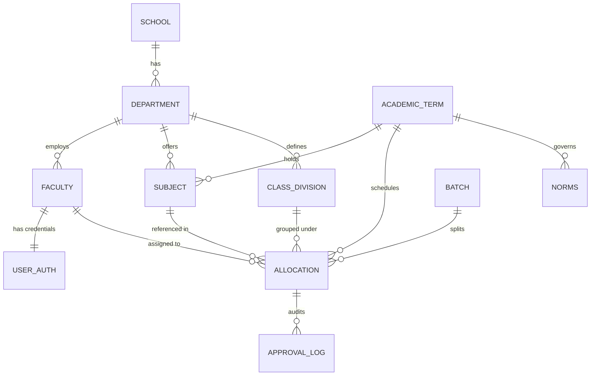
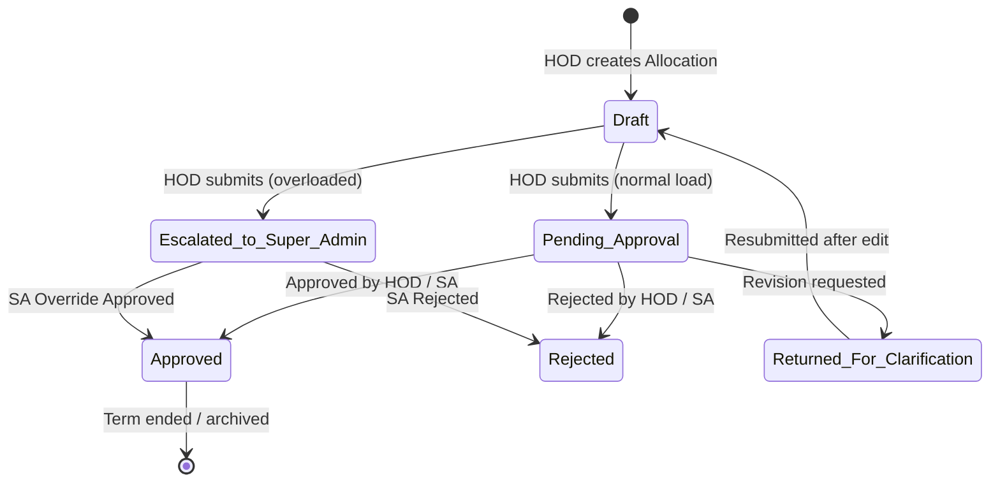

<div align="center">

```
  ██████╗  █████╗ ██████╗ ███████╗██████╗ ██╗     ███████╗███████╗███████╗
  ██╔══██╗██╔══██╗██╔══██╗██╔════╝██╔══██╗██║     ██╔════╝██╔════╝██╔════╝
  ██████╔╝███████║██████╔╝█████╗  ██████╔╝██║     █████╗  ███████╗███████╗
  ██╔═══╝ ██╔══██║██╔═══╝ ██╔══╝  ██╔══██╗██║     ██╔══╝  ╚════██║╚════██║
  ██║     ██║  ██║██║     ███████╗██║  ██║███████╗███████╗███████║███████║
  ╚═╝     ╚═╝  ╚═╝╚═╝     ╚══════╝╚═╝  ╚═╝╚══════╝╚══════╝╚══════╝╚══════╝
```

# 🧾 SOET Paperless · Faculty Workload Management System

### *A modern, enterprise-grade academic workload governance platform — digitizing the way MGM University SOET manages teaching allocations.*

<br/>

[](https://nodejs.org/)
[](https://www.typescriptlang.org/)
[](https://react.dev/)
[](https://expressjs.com/)
[](https://www.prisma.io/)
[](https://deepmind.google/technologies/gemini/)
[](https://www.sqlite.org/)
[](./LICENSE)

<br/>

> **Built for:** MGM University · School of Engineering & Technology (SOET)
>
> **Design System:** Ventriloc · Signal Orange `#ff682c` · Mist `#efefef` · Carbon `#202020`

<br/>

---

</div>

## 📖 Table of Contents

- [✨ What is FWMS?](#-what-is-fwms)
- [🎯 Key Highlights](#-key-highlights)
- [🏗️ Architecture Overview](#️-architecture-overview)
- [🛠️ Tech Stack](#️-tech-stack)
- [📁 Project Structure](#-project-structure)
- [🗄️ Database Schema](#️-database-schema)
- [🔐 Security Architecture](#-security-architecture)
- [⚙️ Core Business Engines](#️-core-business-engines)
- [🤖 AI-Powered Document Ingestion](#-ai-powered-document-ingestion)
- [📊 Analytics Dashboards](#-analytics-dashboards)
- [🔄 Allocation State Machine](#-allocation-state-machine)
- [👥 User Roles & Permissions](#-user-roles--permissions)
- [🚀 Getting Started](#-getting-started)
- [🔑 Default Test Accounts](#-default-test-accounts)
- [🌐 API Reference](#-api-reference)
- [🎨 Design System](#-design-system-ventriloc)
- [📈 Roadmap](#-release-roadmap)

---

## ✨ What is FWMS?

The **Faculty Workload Management System (FWMS)** is the **Part 1** of the Paperless SOET initiative — a comprehensive platform that **completely eliminates paper-based faculty workload distribution** at MGM University's School of Engineering & Technology.

Historically, academic institutions relied on paper forms, static spreadsheets, and manual calculations to distribute teaching hours. This legacy process led to:

- 🚫 Allocation errors & double-booked slots
- 🚫 Untracked overload/underload conditions
- 🚫 Delayed approvals with no SLA enforcement
- 🚫 High administrative burden with zero auditability

**FWMS replaces all of this** with automated workload calculations, real-time conflict detection, AI document ingestion, multi-tier approval workflows, and rich role-specific analytics dashboards.

---

## 🎯 Key Highlights

<table>
<tr>
<td width="33%" align="center">

### 🤖 AI-Powered Ingestion
Upload a scanned workload sheet (PDF/JPEG/PNG) and **Gemini 2.5 Flash** extracts all data into structured records in seconds — eliminating days of manual entry.

</td>
<td width="33%" align="center">

### ⚡ Real-Time Conflict Engine
Hard constraint double-booking prevention and soft overload detection run on every allocation write — returning `409 Conflict` before errors reach production.

</td>
<td width="33%" align="center">

### 🔐 Zero-Trust Security
Dual JWT (15-min access + 7-day `httpOnly` refresh), bcrypt hashing, rate limiting, and RBAC middleware provide enterprise-grade authentication security.

</td>
</tr>
<tr>
<td width="33%" align="center">

### 📊 Rich Analytics
Recharts-powered dashboards — Radial Gauge, Donut Charts, Stacked Bar Charts, and a color-coded Workload Heatmap Grid — give instant institutional visibility.

</td>
<td width="33%" align="center">

### 🕐 Automated SLA Cron
A daily midnight background job automatically escalates pending allocations overdue beyond SLA thresholds directly to Super Admin for resolution.

</td>
<td width="33%" align="center">

### 📋 Full Audit Trail
Every status change, override approval, password reset, and login attempt is logged in immutable audit records — 100% traceable governance.

</td>
</tr>
</table>

---

## 🏗️ Architecture Overview

```
┌─────────────────────────────────────────────────────────────────────┐
│                        SOET Paperless — FWMS                        │
│                                                                     │
│  ┌─────────────────────┐          ┌──────────────────────────────┐  │
│  │   React + Vite      │  HTTP    │    Express.js REST API        │  │
│  │   Frontend (Web)    │◄────────►│    Node.js Backend           │  │
│  │                     │  Bearer  │                              │  │
│  │  · Zustand State    │  JWT     │  · Prisma ORM (SQLite)       │  │
│  │  · Recharts Graphs  │          │  · JWT Auth Engine           │  │
│  │  · Ventriloc UI     │          │  · Rate Limiting & Helmet    │  │
│  │  · Silent Refresh   │          │  · Cron SLA Escalation       │  │
│  │                     │          │  · Gemini AI Integration     │  │
│  └─────────────────────┘          └──────────────────────────────┘  │
│           :3000                              :4000                   │
│                                                                     │
│           ┌────────────────────────────────────┐                    │
│           │         npm workspaces             │                    │
│           │  fwms/packages/shared              │                    │
│           │  (TypeScript types, Zod schemas,   │                    │
│           │   enums — shared across both apps) │                    │
│           └────────────────────────────────────┘                    │
└─────────────────────────────────────────────────────────────────────┘
```

---

## 🛠️ Tech Stack

| Layer | Technology | Purpose |
|:---|:---|:---|
| **Frontend** | React 18 + Vite | Modern SPA with fast HMR and optimized builds |
| **State Management** | Zustand | Lightweight, boilerplate-free client state |
| **Charts & Analytics** | Recharts | Radial gauges, donut charts, bar charts, heatmaps |
| **Backend API** | Node.js + Express.js | RESTful API with modular domain architecture |
| **ORM & Database** | Prisma + SQLite / PostgreSQL | Type-safe DB access; SQLite dev, PostgreSQL-ready prod |
| **Authentication** | JWT (Dual Token) + bcryptjs | Short-lived access + long-lived refresh via `httpOnly` cookie |
| **AI Integration** | Google Gemini 2.5 Flash | Document OCR and structured data extraction pipeline |
| **Validation** | Zod | Runtime schema validation on API boundaries |
| **Security** | Helmet + express-rate-limit | HTTP hardening and route-level rate limiting |
| **Background Jobs** | Node.js Cron | Daily SLA escalation at midnight |
| **Monorepo** | npm workspaces | Shared packages across `api`, `web`, and `shared` |
| **Language** | TypeScript 5.7 | End-to-end type safety across the entire stack |

---

## 📁 Project Structure

```
SOET-Paperless-Part1/
│
├── DESIGN.md                        # 📐 Ventriloc design system (comprehensive)
├── PRD.md                           # 📋 Product Requirements Document
├── PROJECT_OVERVIEW.md              # 🗺️ Technical architectural overview
│
└── fwms/                            # 🏠 Main npm workspace root
    ├── package.json                 # Monorepo scripts & workspace config
    ├── docker-compose.yml           # Container orchestration
    ├── .env.example                 # Environment variable template
    │
    ├── apps/
    │   │
    │   ├── api/                     # 🔧 Express.js Backend
    │   │   ├── prisma/
    │   │   │   ├── schema.prisma    # Complete database schema
    │   │   │   └── migrations/      # Version-controlled DB migrations
    │   │   └── src/
    │   │       ├── server.ts        # Entry point — middleware & route mounting
    │   │       ├── cron/
    │   │       │   └── sla-escalation.ts    # Daily SLA background job
    │   │       ├── lib/
    │   │       │   ├── prisma.ts    # Prisma client singleton
    │   │       │   ├── jwt.ts       # Token generation & verification
    │   │       │   └── logger.ts    # Structured logging utility
    │   │       ├── middleware/
    │   │       │   ├── auth.ts              # JWT verification middleware
    │   │       │   ├── role-guard.ts        # RBAC role enforcement
    │   │       │   ├── dept-scope.ts        # HOD department scoping
    │   │       │   └── error-handler.ts     # Centralized error handler
    │   │       └── modules/                 # Domain-driven module layout
    │   │           ├── auth/                # Login, logout, refresh, password reset
    │   │           ├── institutional/       # Schools, departments, academic terms
    │   │           ├── faculty/             # Faculty CRUD & profile management
    │   │           ├── subjects/            # Subject master with multipliers
    │   │           ├── classes-batches/     # Class divisions & lab batches
    │   │           ├── workload-engine/     # Hour calculation service
    │   │           ├── conflict-engine/     # Double-booking & overload detection
    │   │           ├── allocations/         # Core allocation lifecycle CRUD
    │   │           ├── approvals/           # Approval state transitions & logs
    │   │           ├── dashboard/           # Role-specific aggregated analytics
    │   │           ├── workload-report/     # Gemini AI ingestion & report generation
    │   │           └── schedule-data/       # Schedule export & data utilities
    │   │
    │   └── web/                     # 🌐 React + Vite Frontend
    │       └── src/
    │           ├── App.jsx           # Root app with routing
    │           ├── main.jsx          # Vite entry point
    │           ├── index.css         # Ventriloc CSS variables & global styles
    │           ├── components/
    │           │   ├── dashboard/    # Role dashboards (Faculty, HOD, Super Admin)
    │           │   ├── workload-report/ # AI ingestion UI
    │           │   └── ui/          # Shared UI primitives
    │           ├── pages/           # Route-level page components
    │           ├── layouts/         # Dashboard layout wrappers
    │           ├── lib/
    │           │   └── api-client.ts # Axios client with silent JWT refresh
    │           └── stores/
    │               └── auth-store.ts # Zustand authentication state
    │
    └── packages/
        └── shared/                  # 📦 Shared TypeScript types & schemas
            └── src/
                ├── types/           # Shared interfaces (Faculty, Allocation, etc.)
                ├── schemas/         # Zod validation schemas
                └── enums/           # Shared enumerations (Role, Status, etc.)
```

---

## 🗄️ Database Schema



### Core Models

| Model | Description |
|:---|:---|
| `School` | Top-level institutional unit (e.g., School of Engineering & Technology) |
| `Department` | Academic unit under a school (e.g., CSE), headed by an HOD |
| `AcademicTerm` | Year + semester tracking (e.g., "2026-27, Part 1") with `active`/`archived` states |
| `Faculty` | Teaching staff with `Designation`, `EmploymentType`, and department affiliation |
| `UserAuth` | Login credentials, hashed passwords, role, lockout tracking, and security flags |
| `Subject` | Course records with credit hours and theory/practical/tutorial multipliers |
| `Norms` | Per-designation weekly hour bands (`minWeeklyHours`, `maxWeeklyHours`) and SLA config |
| `ClassDivision` | A class section (e.g., "TE (I) CE - Div A") |
| `Batch` | Lab sub-groups (e.g., Batch B1, B2) split by student strength |
| `Allocation` | Core record mapping faculty → subject → class/batch for a term with computed hours |
| `ApprovalLog` | Immutable audit trail of every status transition on allocations |
| `WorkloadReport` | AI-ingested or manually compiled departmental workload snapshot |

---

## 🔐 Security Architecture

```
  Client                         Server
  ──────                         ──────
  [Login]  ──── POST /auth/login ───►  [Verify password (bcrypt)]
                                       [Generate Access Token (15 min)]
  ◄── Bearer Token + httpOnly Cookie ── [Generate Refresh Token (7 days)]

  [API Request] ── Bearer: <access_token> ──► [authenticate middleware]
                                               [requireRole middleware]
                                               [requireDeptScope middleware]

  [Token Expires]  ──── 401 Unauthorized ──►  [apiClient intercepts]
                   ◄── New Access Token ─────  [POST /auth/refresh]
                   [Replay queued requests]    [httpOnly cookie validated]
```

### Security Features

- 🔑 **Dual JWT Architecture** — Short-lived access tokens in memory + long-lived refresh tokens in `httpOnly`, `sameSite: strict` cookies
- 🛡️ **Silent Token Refresh** — Frontend API client transparently queues and replays requests on expiry without user interruption
- 🔒 **bcrypt Hashing** — Minimum 10 salt rounds on all stored passwords
- 🚦 **Rate Limiting** — Auth routes: 10 req/min · General API: 100 req/min via `express-rate-limit`
- 🪖 **Helmet.js** — Full HTTP security headers (CSP, X-Frame-Options, HSTS, etc.)
- 🎭 **RBAC Middleware** — `requireRole`, `requireDeptScope`, `requireSelfOrAdmin` guards on every sensitive route
- 📜 **Audit Logs** — Authentication attempts, lockouts, and overrides tracked in `AuditLog`

---

## ⚙️ Core Business Engines

### 🔢 Workload Calculation Engine

The engine computes weekly teaching hours from subject configuration:

```
Theory Hours    = Credit Hours × Theory Multiplier        (class-level)
Practical Hours = Credit Hours × Practical Multiplier     (per batch)
Tutorial Hours  = tutorialHours × Batch Count             (if applicable)

Total Weekly Hours = Theory + Practical + Tutorial
```

> ⚡ Any change to subject multipliers **automatically triggers recalculation** across all linked active allocations.

### ⚔️ Conflict & Constraint Engine

Two enforcement layers run on every allocation write:

| Constraint | Type | Behavior |
|:---|:---|:---|
| **Double-Booking** | Hard (blocks) | Same class/batch → >1 faculty for same subject → `409 Conflict` |
| **Overload Detection** | Soft (escalates) | `Projected Hours > maxWeeklyHours` → flags `requiresSaOverride = true` |
| **Underload Warning** | Soft (warns) | `Projected Hours < minWeeklyHours` → warns HOD to assign additional duties |

---

## 🤖 AI-Powered Document Ingestion

One of FWMS's most powerful features — upload a **physical workload sheet scan** and let AI do the rest:

```
 HOD uploads PDF / JPEG / PNG (up to 20MB)
         │
         ▼
 Express Multer receives file buffer
         │
         ▼
 File → Base64 → Gemini 2.5 Flash API
 (Prompt enforces strict JSON schema mapping)
         │
         ▼
 Structured WorkloadReport JSON returned
         │
    ┌────┴────┐
    │         │
  dry-run    commit
    │         │
  Preview   Persist to DB
  table     (WorkloadReportRow records)
```

| Detail | Value |
|:---|:---|
| **Supported Formats** | JPEG · PNG · WEBP · PDF |
| **Max File Size** | 20 MB |
| **AI Model** | Google Gemini 2.5 Flash |
| **Efficiency Gain** | > 90% reduction in workload sheet import time |

---

## 📊 Analytics Dashboards

### 🧑‍🎓 Faculty Dashboard
- **Radial Progress Gauge** — Visual workload hours vs. designation limit
- **Subject Schedule Cards** — Assigned subjects, divisions, and batch details
- **Vertical Audit Timeline** — Status history of recent allocation requests

### 🏫 HOD (Dept. Admin) Dashboard
- **Department Summary Cards** — Total faculty, avg. workload, overload count
- **Course Distribution Donut Chart** — Hour breakdown across all courses
- **Faculty Workload Table** — Inline allocation controls & one-click approval

### 👑 Super Admin Dashboard
- **Institutional Aggregate Metrics** — System-wide counts (faculty, allocations, escalations)
- **Stacked Bar Chart** — Theory vs. Practical hours distribution per department
- **Workload Heatmap Grid** — Color-coded per-faculty status:

| Color | State | Meaning |
|:---|:---|:---|
| 🟢 Green `#10B981` | Normal | Within `minWeeklyHours` – `maxWeeklyHours` |
| 🟡 Amber `#F59E0B` | Underload | Below `minWeeklyHours` |
| 🟠 Orange `#ff682c` | Overload | Exceeds `maxWeeklyHours`, requires SA override |
| 🔴 Red `#EF4444` | Escalated | SLA exceeded — urgent Super Admin action required |

---

## 🔄 Allocation State Machine



> **⏰ Automated SLA Cron:** A background job runs **every night at midnight**. Allocations in `pending_approval` beyond `slaDaysForHodReview` (default: 3 days) are automatically escalated to Super Admin with a full escalation log entry.

---

## 👥 User Roles & Permissions

| Role | Access Level | Key Capabilities |
|:---|:---|:---|
| 👑 **Super Admin** | Full system | Manage schools, departments, terms, norms. Approve overloaded allocations. Handle SLA escalations & SA overrides. |
| 🏫 **HOD (Dept. Admin)** | Department-scoped | Manage faculty, subjects, classes, batches. Create & submit allocations. Approve normal-load allocations. Upload AI workload sheets. |
| 🧑‍🏫 **Faculty** | Self-view only | View personal schedule, assigned subjects & batches, workload gauge, and request status audit timeline. |

---

## 🚀 Getting Started

### Prerequisites

```
Node.js  ≥ 20.0.0
npm      ≥ 9.0.0
```

### 1️⃣ Clone & Install

```bash
git clone https://github.com/Nadeem-Shaikh12/SOET-Paperless-Part1.git
cd SOET-Paperless-Part1/fwms

npm install
```

### 2️⃣ Configure Environment

```bash
cp .env.example .env
```

Edit `.env` with your values:

```env
# Database
DATABASE_URL="file:./prisma/dev.db"

# JWT Secrets (use strong random strings in production)
JWT_ACCESS_SECRET=your_access_secret_here
JWT_REFRESH_SECRET=your_refresh_secret_here
JWT_ACCESS_EXPIRES_IN=15m
JWT_REFRESH_EXPIRES_IN=7d

# Google Gemini AI
GEMINI_API_KEY=your_gemini_api_key_here

# Server
API_PORT=4000
FRONTEND_URL=http://localhost:3000
NODE_ENV=development
```

### 3️⃣ Database Setup

```bash
# Apply schema migrations (creates dev.db SQLite file)
npm run db:migrate

# Seed default roles, admin accounts & sample data
npm run db:seed

# (Optional) Open Prisma Studio GUI
npm run db:studio
```

### 4️⃣ Launch Development Servers

```bash
# Starts API on :4000 and Web on :3000 concurrently
npm run dev
```

Or run individually:

```bash
npm run dev:api    # API server only
npm run dev:web    # Web frontend only
```

### ✅ Verify the Installation

| Service | URL | Expected |
|:---|:---|:---|
| API Health Check | `http://localhost:4000/health` | `{ "status": "ok" }` |
| Web Application | `http://localhost:3000` | Login page |
| Prisma Studio | `http://localhost:5555` | DB GUI (after `npm run db:studio`) |

---

## 🔑 Default Test Accounts

> ⚠️ These are **development seed accounts only**. Change all credentials before any production deployment.

| Role | Email | Password | Access Level |
|:---|:---|:---|:---|
| 👑 Super Admin | `admin@mgm.edu` | `Admin@123` | Full system control |
| 🏫 HOD (CSE Dept.) | `hod.cse@mgm.edu` | `Hod@123` | Department-scoped admin |
| 🧑‍🏫 Faculty Member | `john.smith@mgm.edu` | `Faculty@123` | Personal dashboard view |

---

## 🌐 API Reference

All API routes are prefixed with `/api/v1`.

| Module | Base Route | Description |
|:---|:---|:---|
| **Auth** | `/api/v1/auth` | Login, logout, token refresh, password reset |
| **Institutional** | `/api/v1/institutional` | Schools, departments, academic terms |
| **Faculty** | `/api/v1/faculty` | Faculty CRUD & profile management |
| **Subjects** | `/api/v1/subjects` | Subject master with credit/multiplier config |
| **Classes & Batches** | `/api/v1/classes`, `/api/v1/student-strength` | Class divisions and lab batch management |
| **Allocations** | `/api/v1/allocations` | Core allocation lifecycle CRUD |
| **Approvals** | `/api/v1/approvals` | Status transitions and approval actions |
| **Dashboard** | `/api/v1/dashboard` | Role-specific aggregated analytics data |
| **Workload Report** | `/api/v1/workload-report` | AI document ingestion & report endpoints |
| **Schedule Data** | `/api/v1/schedule-data` | Schedule export utilities |

---

## 🎨 Design System: Ventriloc

FWMS uses a custom **"Ventriloc"** design system — a quiet, professional UI where data takes center stage.

> *"A workspace where data feels approachable rather than intimidating."*

### Color Palette

| Token | Hex | Role |
|:---|:---:|:---|
| **Signal Orange** | `#ff682c` | Brand accent — charts, active nav, overload alerts. The **only** chromatic color. |
| **Carbon** | `#202020` | Primary text, filled buttons, sidebar headers |
| **Graphite** | `#4d4d4d` | Secondary text, icon strokes |
| **Slate** | `#828282` | Helper text, inactive items, tertiary borders |
| **Mist** | `#efefef` | Page canvas background |
| **Paper** | `#ffffff` | Card & panel surfaces |
| **Chalk** | `#e8e8e8` | Borders, dividers |

### Typography

- **Display / Headers:** PolySans — condensed, architectural, tight line-height (0.91) for a "compressed monument" effect
- **Body / Controls:** Inter — clean geometric sans-serif

### Component Signatures

- 🃏 **Cards:** `8px` border radius, subtle `#e0e0e0` border strokes, flat elevation via background shift
- 💊 **Buttons:** `20px` pill-shaped with crisp hover micro-animations
- 🧭 **Navigation:** `200px` floating capsule header control styling

---

## 📈 Release Roadmap

All five phases are **production-complete** ✅

| Phase | Description | Status |
|:---|:---|:---:|
| **Phase 1** | Core Platform & Auth — Monorepo, Prisma schema, Dual JWT, RBAC middleware | ✅ Done |
| **Phase 2** | Workload & Conflict Engine — Master data CRUD, hour multipliers, double-booking prevention, overload detection | ✅ Done |
| **Phase 3** | Approval State Machine & SLA Cron — Multi-stage lifecycle, audit log, automated daily SLA escalation | ✅ Done |
| **Phase 4** | AI Document Ingestion — Gemini 2.5 Flash OCR pipeline, structured JSON parser, dry-run preview UI | ✅ Done |
| **Phase 5** | Dashboards & Design Polish — Recharts suite (Radial Gauge, Donut, Stacked Bar, Heatmap), Ventriloc theme | ✅ Done |

---

## 🤝 Contributing

This project is developed as part of the **Paperless SOET** initiative for **MGM University**.

1. Fork the repository
2. Create a feature branch: `git checkout -b feature/your-feature-name`
3. Follow existing TypeScript + Zod validation patterns in `packages/shared`
4. Ensure new API routes have proper RBAC middleware applied
5. Submit a Pull Request with a clear description

---

<div align="center">

---

**Made with ❤️ for MGM University — School of Engineering & Technology**

*Paperless SOET · FWMS v1.0.0 · 2026*

[](https://github.com/Nadeem-Shaikh12/SOET-Paperless-Part1)

</div>
